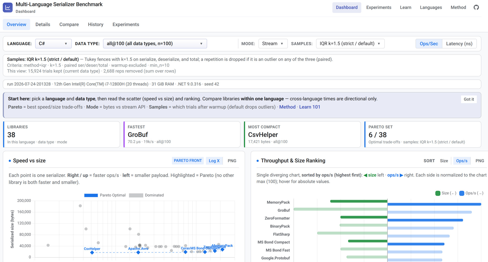

# Multi-Language Serializer Benchmark

>[Serialization](https://leo-gan.github.io/serialization/) - a hub for the theory, the history, etc.

[](https://leo-gan.github.io/GLD.SerializerBenchmark/)
[](https://leo-gan.github.io/GLD.SerializerBenchmark/dashboard/)
[](https://leo-gan.github.io/GLD.SerializerBenchmark/theory/101/)
[](LICENSE)
[](#supported-languages)

Compare 400+ serialization libraries across **14 languages**.

<p align="center">
  <a href="https://leo-gan.github.io/GLD.SerializerBenchmark/dashboard/">
    
  </a>
  <br />
</p>

---

## Who it is for

| Audience | Use case | Course |
|----------|----------|--------|
| **Computer science students** | Theory, history, worked examples | [101](https://leo-gan.github.io/GLD.SerializerBenchmark/theory/101/), [201](https://leo-gan.github.io/GLD.SerializerBenchmark/theory/201/) |
| **System integrators** | Pick formats that fit payloads and runtimes | [301](https://leo-gan.github.io/GLD.SerializerBenchmark/theory/301/) |
| **Researchers** | Reproducible measurement and experiments | [Methodology](https://leo-gan.github.io/GLD.SerializerBenchmark/analysis/ANALYSIS_METHODOLOGY/) · [301](https://leo-gan.github.io/GLD.SerializerBenchmark/theory/301/) |
| **Serializer authors** | Add a codec, version A/B, regression checks | [Adding a serializer](https://leo-gan.github.io/GLD.SerializerBenchmark/analysis/ADDING_A_SERIALIZER/) · [401](https://leo-gan.github.io/GLD.SerializerBenchmark/theory/401/) |

---

## Supported languages

- [C](https://leo-gan.github.io/GLD.SerializerBenchmark/c/) — 21 serializers
- [C# (.NET)](https://leo-gan.github.io/GLD.SerializerBenchmark/c-sharp/) — 56
- [C++](https://leo-gan.github.io/GLD.SerializerBenchmark/cpp/) — 40
- [Fortran](https://leo-gan.github.io/GLD.SerializerBenchmark/fortran/) — 9
- [Go](https://leo-gan.github.io/GLD.SerializerBenchmark/go/) — 35
- [Java](https://leo-gan.github.io/GLD.SerializerBenchmark/java/) — 30
- [JavaScript](https://leo-gan.github.io/GLD.SerializerBenchmark/javascript/) — 34
- [Kotlin](https://leo-gan.github.io/GLD.SerializerBenchmark/kotlin/) — 34
- [Mojo](https://leo-gan.github.io/GLD.SerializerBenchmark/mojo/) — 21
- [PHP](https://leo-gan.github.io/GLD.SerializerBenchmark/php/) — 18
- [Python](https://leo-gan.github.io/GLD.SerializerBenchmark/python/) — 37
- [Rust](https://leo-gan.github.io/GLD.SerializerBenchmark/rust/) — 33
- [Swift](https://leo-gan.github.io/GLD.SerializerBenchmark/swift/) — 23
- [Zig](https://leo-gan.github.io/GLD.SerializerBenchmark/zig/) — 17

---

## Try it: two quality questions

Requires a recent `Python` and [uv](https://docs.astral.sh/uv/). No Docker.

```bash
git clone https://github.com/leo-gan/GLD.SerializerBenchmark.git
cd GLD.SerializerBenchmark

./scripts/check-host-requirements.sh python   # optional: see what's missing
./scripts/install-host-requirements.sh python # optional: user-local toolchains

# How fast / how big?
cd python && ./scripts/run-benchmarks.sh smoke
# → logs/python/YYYY-MM-DD-HHMMSS.csv

# Does it match the cited RFC / spec section?
./scripts/run-compliance.sh
# → logs/compliance/YYYY-MM-DD-HHMMSS.json
```

Then open the [Dashboard](https://leo-gan.github.io/GLD.SerializerBenchmark/dashboard/?lang=python)
for timings, or [Compliance](https://leo-gan.github.io/GLD.SerializerBenchmark/dashboard/#compliance/python) for the standard compliance.

Prefer `Rust` benches? `./scripts/run-all-benchmarks.sh --mode smoke --lang rust`

---

## Quick start

Benchmark runners run **natively on the host** (no Docker). Prepare toolchains once, then run benchmarks (project deps like `uv sync` / `npm install` still happen inside each runner).

```bash
# 1) Host toolchains (compilers/runtimes only)
./scripts/check-host-requirements.sh
./scripts/install-host-requirements.sh
./scripts/install-host-requirements.sh csharp   # one language

# 2) Smoke one language
./python/scripts/run-benchmarks.sh smoke
# or: ./rust/scripts/run-benchmarks.sh smoke

# Orchestrator: all languages or one language
./scripts/run-all-benchmarks.sh --mode all-single
./scripts/run-all-benchmarks.sh --mode full --lang rust

# Analysis package (writes reports/; Dashboard via sync-data.py)
cd analysis && uv pip install -e .   # or: pip install -e .
analyze-benchmarks
analyze-benchmarks -l python
analyze-benchmarks --compare-a rust:2026-07-09-194122 --compare-b rust:latest
```

**Modes**: `smoke` (2 reps) · `all-single` (10) · `full` (100) · `research` (500).

`analyze-benchmarks` writes `reports/`; Dashboard via `sync-data.py`. Review and commit before `publish-docs` deploys the site.

---

## Test data

Every language serializes the same samples. A **data set** is the group measured in one run. A **data type** is one shape inside that group. 

| Data set | Data types |
|----------|------------|
| **Suite** (default) | Five everyday records: a flat message, a nested document, numeric telemetry, a block of strings, and an event |
| **Columnar** | Wide tables: a full row, a single-column read, a nested table, and an aligned record |
| **Graph** | One network of shared objects, including a cycle |
| **Array** | One dense grid of numbers, and a window read from that grid |
| **Tensor** | Machine-learning payloads: a float matrix, a borrowed read of that matrix, a prompt, a weight shard, and a request |

---

## Statistics

- [Analysis methodology](https://leo-gan.github.io/GLD.SerializerBenchmark/analysis/ANALYSIS_METHODOLOGY/)
- [Metrics catalog](https://leo-gan.github.io/GLD.SerializerBenchmark/analysis/METRICS/)

Compare serializers **within one language and one standard**. Cross-language absolute times are directional only — runtimes and GCs differ.

> Kiln, a frozen positional wire format implemented from scratch in 11
> languages and benchmarked in this project: https://github.com/leo-gan/gld-kiln
