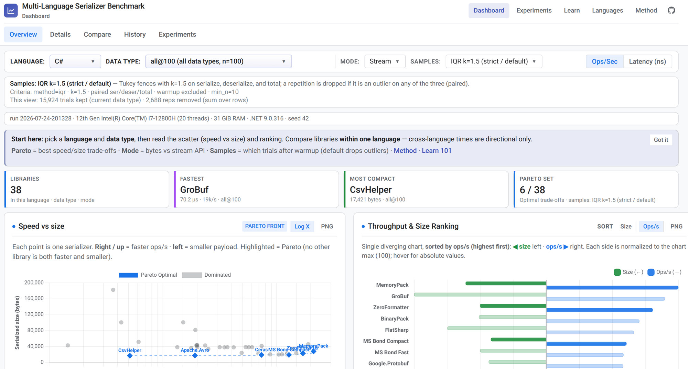

---
# No in-page title (site header has the product name). Browser tab uses site_name.
hide:
  - navigation
  - toc
  - title
---

Compare **200+** serialization libraries across **14 languages** with fair
within-language rankings—not marketing microbenchmarks.

[Open live Dashboard](dashboard/index.html){ .md-button .md-button--primary }
[Start Serialization 101](theory/101/index.md){ .md-button }
[How we measure](analysis/index.md){ .md-button }

---

## What this project is

This suite runs the **same data shapes** through serializers in many programming
languages, writes a **shared CSV contract**, and analyzes results with one
statistics pipeline. Use it to compare libraries **inside one language, one
standard, one data set, and one data type**, not to crown a single global winner.

| You want… | Go here |
|-----------|---------|
| Interactive charts, Pareto trade-offs, compare lab | **[Dashboard](dashboard/index.html)** |
| One-question tests (why we do not only use the big table) | **[Experiments](experiments/index.md)** |
| Does this library match the RFC / spec section? | **[Dashboard · Compliance](dashboard/index.html#compliance)** (`#compliance/{lang}/{serializer}`) · [catalog notes](compliance/index.md) |
| Course syllabus, formats, and trade-offs (101–401) | **[Learn](theory/index.md)** |
| Per-language runtime matrix, library rosters, and caveats | **[Languages](languages/index.md)** |
| Methodology, metrics, how to add a codec | **[Benchmarks](analysis/index.md)** |
| The five data sets (suite, columnar, graph, array, tensor) | **[Data sets](analysis/test_data_configuration.md)** |
| The words this site uses (data set, data type, runner) | **[Terminology](analysis/terminology.md)** |

---

## Same data · same pipeline

The live **Dashboard** is the published home for measured numbers. Pick a
language, a standard, and a data type, then read speed vs size and the ranking. Language
indexes list the roster and caveats.

[{ width="780" }](dashboard/index.html)

---

## Languages

Fourteen benchmark runners share the same data types and analysis rules. Each language **Overview** lists the registered serializers and caveats; measured numbers live on the **Dashboard**.

| Language | Overview | Live numbers |
|----------|----------|--------------|
| C | [Overview](c/index.md) | [Dashboard](dashboard/index.html?lang=c) |
| C# | [Overview](c-sharp/index.md) | [Dashboard](dashboard/index.html?lang=csharp) |
| C++ | [Overview](cpp/index.md) | [Dashboard](dashboard/index.html?lang=cpp) |
| Fortran | [Overview](fortran/index.md) | [Dashboard](dashboard/index.html?lang=fortran) |
| Go | [Overview](go/index.md) | [Dashboard](dashboard/index.html?lang=go) |
| Java | [Overview](java/index.md) | [Dashboard](dashboard/index.html?lang=java) |
| JavaScript | [Overview](javascript/index.md) | [Dashboard](dashboard/index.html?lang=javascript) |
| Kotlin | [Overview](kotlin/index.md) | [Dashboard](dashboard/index.html?lang=kotlin) |
| Mojo | [Overview](mojo/index.md) | [Dashboard](dashboard/index.html?lang=mojo) |
| PHP | [Overview](php/index.md) | [Dashboard](dashboard/index.html?lang=php) |
| Python | [Overview](python/index.md) | [Dashboard](dashboard/index.html?lang=python) |
| Rust | [Overview](rust/index.md) | [Dashboard](dashboard/index.html?lang=rust) |
| Swift | [Overview](swift/index.md) | [Dashboard](dashboard/index.html?lang=swift) |
| Zig | [Overview](zig/index.md) | [Dashboard](dashboard/index.html?lang=zig) |

---

## Learn the ideas first (optional path)

If you are new to serialization, start with the course under **Learn**:

1. [Serialization 101](theory/101/index.md) — workload, standard, implementation, and evaluation  
2. [Serialization 201](theory/201/index.md) — how formats work under the hood  
3. [Serialization 301](theory/301/index.md) — production judgment  
4. [Serialization 401](theory/401/index.md) — wire formats and labs  

Then return to the **[Dashboard](dashboard/index.html)** with clearer questions.

---

## Honesty rules (short)

- Prefer comparisons **within one language, one standard, one data set, and one data type**. A family is a teaching cut, coarser than the standard. The sets are on [Data sets](analysis/test_data_configuration.md). See [Families](analysis/families.md).  
- Implementation quality often matters more than the format brand name.  
- Payload shape changes costs a great deal.  
- Numbers on this site are from **this** suite’s runners and analysis—not a universal ranking of all software.

Full methodology: [Benchmarks overview](analysis/index.md) · [Analysis methodology](analysis/ANALYSIS_METHODOLOGY.md) · [Claims and replication](analysis/CLAIMS_AND_REPLICATION.md).
